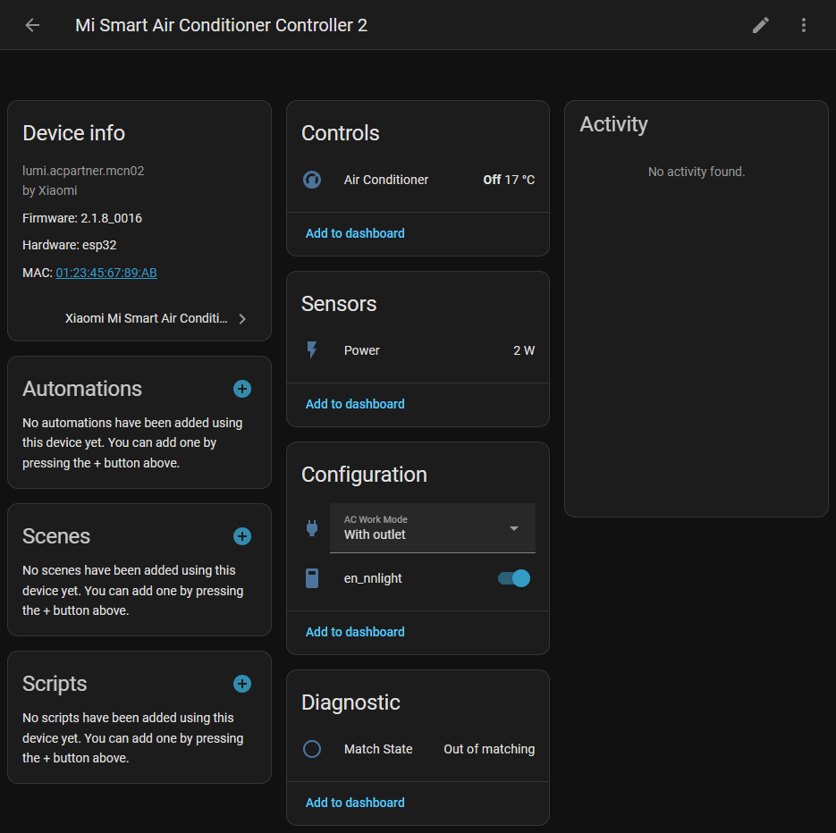

# Xiaomi Mi Smart Air Conditioner Controller 2 Integration

Home Assistant custom integration for [Xiaomi Mi Smart Air Conditioner Controller 2 (lumi.acpartner.mcn02)](https://home.mi.com/webapp/content/baike/product/index.html?model=lumi.acpartner.mcn02).

## Installation

Copy the `custom_component` folder to your Home Assistant configuration folder.

## Configuration

* **Auto discovery**: Xiaomi Mi Smart Air Conditioner Controller 2 can be auto-discovered by Home Assistant. If an instance was found, it will be shown as Discovered. You can then set it up right away.
* **Manual configuration**: Settings > Devices & services > Add Integration > Search Xiaomi Mi Smart Air Conditioner Controller 2, following the instructions on screen to complete the setup.

Access token reqiured for the setup. Follow the instructions on [Retrieving the Access](https://www.home-assistant.io/integrations/xiaomi_miio#retrieving-the-access-token) Token to get the access token.

## Links

* https://home.mi.com/webapp/content/baike/product/index.html?model=lumi.acpartner.mcn02
* https://home.miot-spec.com/s/lumi.acpartner.mcn02
* http://miot-spec.org/miot-spec-v2/instance?type=urn:miot-spec-v2:device:air-conditioner:0000A004:lumi-mcn02:1
